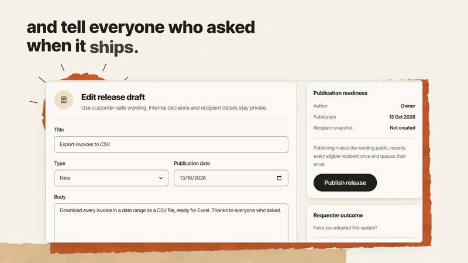
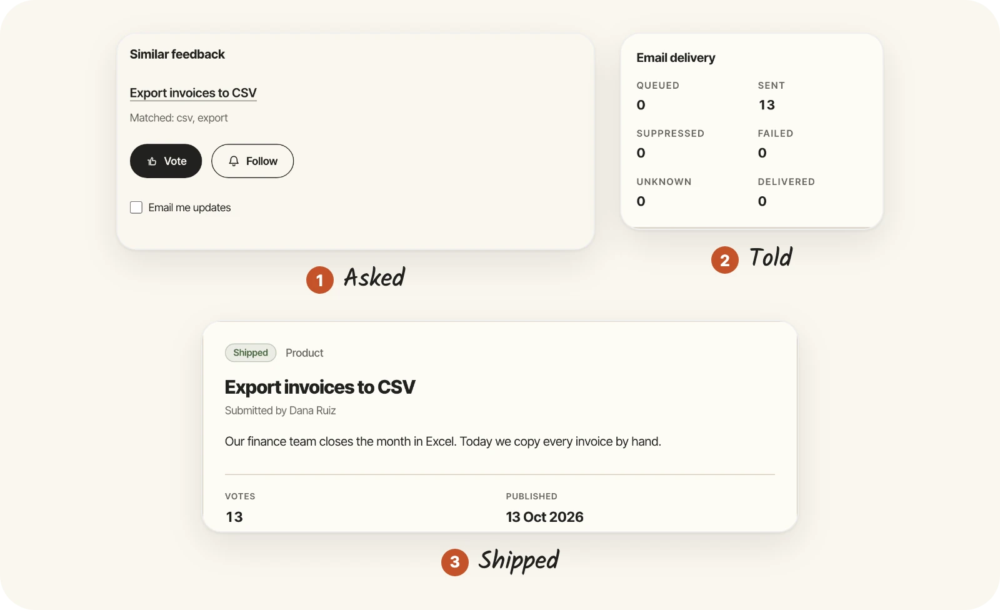
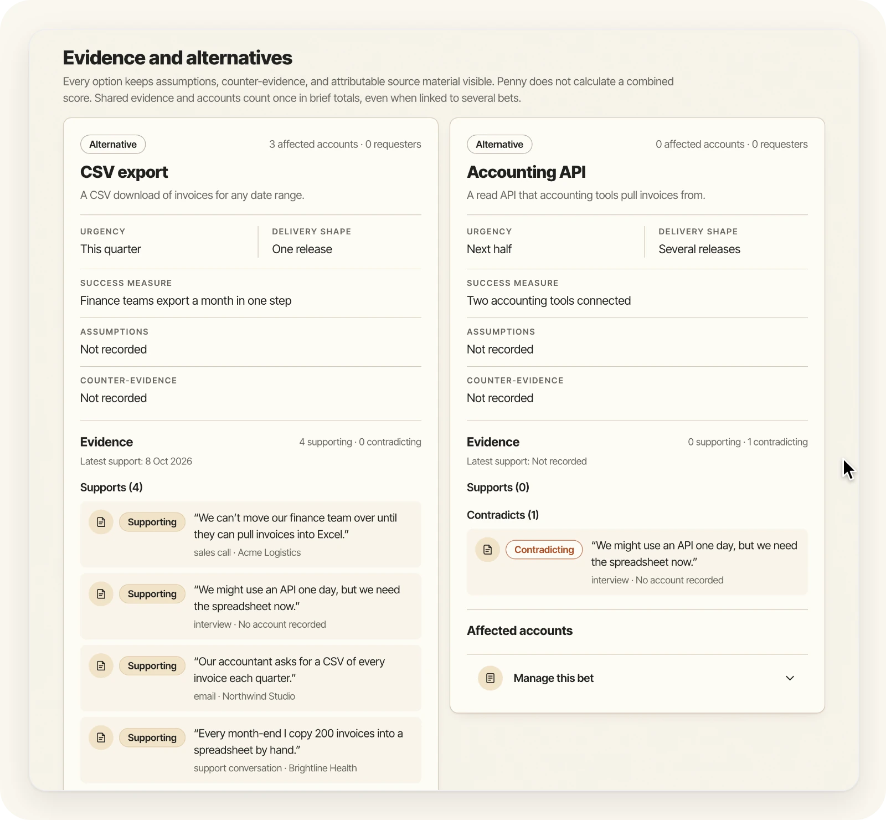
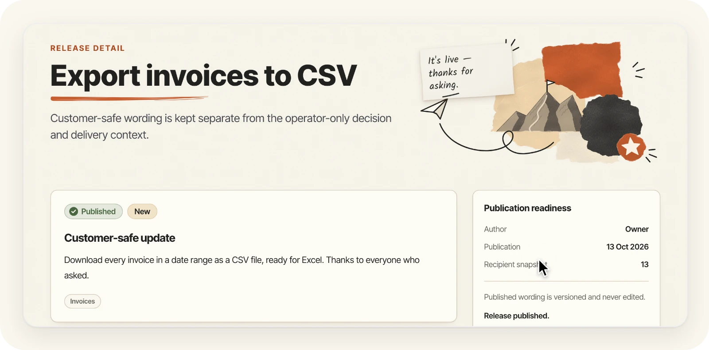

<p align="center">
  <a href="https://run-penny.com">
    <picture>
      <source media="(prefers-color-scheme: dark)" srcset=".github/assets/banner-dark.webp">
      <source media="(prefers-color-scheme: light)" srcset=".github/assets/banner-light.webp">
      
    </picture>
  </a>
</p>

<p align="center"><a href="https://run-penny.com">run-penny.com</a> · <a href="https://justevery.com">Part of Just Every</a> · <a href="LICENSE">MIT licensed</a></p>

<p align="center">
  <a href="https://justevery.com/#vol-penny"></a>
</p>
<p align="center"><a href="https://justevery.com/#vol-penny"><b>Watch the full demo</b></a> · 54 seconds</p>

<p align="center">
  
</p>

<p align="center">
  <br>
  <sub>Compare bets side by side, with the customers' own words as evidence.</sub>
</p>

<p align="center">
  <br>
  <sub>Publish the release and tell everyone who asked.</sub>
</p>

# Penny

Penny is a self-hosted customer-feedback decision product for one B2B software
business. Customers post and follow requests on a public board; operators record
evidence, compare and commit bets, approve what is public and publish status
updates and release notes. The requester board and the operator decision loop,
with maintained Base operator authentication, RER-provided Managed mail and
selectable SendGrid or Resend mail for Free and Assisted hosting, are implemented.
The public source repository is
[just-every/run-penny](https://github.com/just-every/run-penny). The latest release
is 0.1.2, the annotated tag `v0.1.2` ([RELEASE.md](RELEASE.md); upgrading from 0.0.0 is
[below](#upgrade-from-000)); `main` carries the newest source, which can be ahead of it.
**0.1.2 is a security fix: on 0.1.1 and earlier, erasing a person also deleted other
people's records on their requests. Upgrade now;** [CHANGELOG.md](CHANGELOG.md) says what
was lost and how to recover it. Wider release obligations are in
[ACCEPTANCE.md](ACCEPTANCE.md), and local checks do not establish hosted mail
delivery.

## Run it on your computer

You install nothing first. The installer on [run-penny.com/run](https://run-penny.com/run)
(`curl -fsSL https://runeditrun.com/install.sh | sh`) brings its own Node when you have
none, and `rer dev just-every/run-penny` then clones Penny's `main` branch (the newest
source, which can be ahead of the latest release) and starts it. `rer` downloads the
exact Node (22.20.0) and pnpm (10.12.4) this checkout pins into its own cache and never
changes your global tools, so you do not install pnpm.

Already have Node 22 or newer? This one line does both steps. It installs `rer`, the Run
Edit Run command, clones Penny and starts it; to start it again later, run
`cd run-penny && rer dev`:

<!-- penny-local-commands -->
```bash
npx -y @runeditrun/rer dev just-every/run-penny
```
<!-- /penny-local-commands -->

`rer dev` installs the locked dependencies, sets up a local owner
(the email you gave `rer setup`, or a default `.test` address) with an empty workspace, starts Penny and prints a link
that opens it signed in. Penny pins `@runeditrun/rer` in `package.json` and its
lockfile (currently 0.2.37), and the global `rer` always runs that pinned copy. The first start
takes a few minutes.

To be the owner under your own email address instead, run setup once before the
first `rer dev`:

<!-- penny-owner-commands -->
```bash
rer setup --owner-email you@example.com
rer dev
```
<!-- /penny-owner-commands -->

`setup` builds, applies every migration, saves private settings (mode 0600),
claims the owner and exits; a repeat keeps the owner, the data, the saved origin
and the private settings. Its `--port` (first run only) picks the address.

`rer dev` serves Penny on the first free port from 8787 and prints `RER_READY`,
`RER_SIGNED_IN` with the owner's email, and `RER_OPEN`, a link with this
checkout's private dev key in its `#` fragment. In a terminal it stays in the
foreground (Ctrl-C stops it); started from a script or an agent it returns once
Penny is ready and keeps running in the background until `rer dev --stop`. Open
`RER_OPEN` in your
browser; it trades the key for a local cookie and lands on `/setup`, the owner's
first-run setup: review the owner and press **Finish setup** to open the app.
Until you do, every `/app` page sends the owner back to `/setup`; afterwards
`/setup` opens the app. Keep `RER_OPEN` to yourself: anyone holding the key can
sign in to this local copy. To act as a dev teammate (`teammate@dev.localhost`,
a real operator that exists only in local data) or signed out, stop dev and start
it again with `rer dev --as teammate` or `rer dev --as signed-out`. The nav and title read **Penny Dev**. Sign-in is one click;
mail is silently suppressed and no provider is needed. Without the key, dev
sign-in and anything made in a dev session answer 404 or are refused, even
through a tunnel or proxy; `reset --yes` makes a new key and the old one stops
working.

Verify, reset and move data from the same root:

```bash
rer verify
rer reset --yes
rer export --output exports/penny.rer
rer import --input exports/penny.rer --yes
rer deploy --dry-run
rer describe
```

Stop dev first with `rer dev --stop`: `verify`, `reset`, `export`, `import` and
`deploy` (even `--dry-run`) refuse while dev owns the local state, and say so.
`verify` is the bounded full check. `reset`
prints its contained inventory, refuses active operations, removes only local
data, owner, generated settings and installer state, and keeps exports, source
and deployment receipts. `export` produces a private archive and
`penny.rer.erasure-journal.json` beside it. `import` restores both into an
empty installation (run `setup` afterwards for a fresh owner). An archive
generated before an erasure is refused as stale, even with the latest journal:
generate a new archive and journal together. Unknown or pending effects stay
held, and source operator authority, first-run state, outbox and provider
credentials never transfer. `describe` lists every command, flag and effect.
With Node and pnpm on your PATH, `pnpm run VERB -- FLAGS` is the same dispatcher; use `pnpm run deploy` and
`pnpm run import`, because bare `pnpm deploy` and `pnpm import` are pnpm's own
commands.

`rer preview` serves the fixed production output on the same state, and
`rer preview --stop` stops it; a compatible repeated start reuses the
managed instance, conflicting modes refuse, and idle shutdown defaults to 30
minutes. See [RUN-LOCALLY.md](RUN-LOCALLY.md) for the shared queue and process
policy. Local data lives only in `.wrangler/state`; a sibling
`.penny-local-state-<checkout-name>` store or an external `PENNY_LOCAL_STATE` is
refused before any change. Startup never imports sample records.

## Connect your product and tools

Saved-file feedback imports use [MOVE-IN](docs/MOVE-IN.md). Server-signed host
identity signs requesters into the portal; [HOST-IDENTITY](docs/HOST-IDENTITY.md)
includes a working local host example. It grants no operator authority or email
consent. Native owners alone configure the embedded visual editor and portal
branding; other active operators retain equal product-operation access.

Settings manages named, scoped, optional-expiry API keys, reveals each token
once, and revokes it. [API](docs/API.md) describes the REST routes and explicit
publication approval. [INTEGRATIONS](docs/INTEGRATIONS.md) describes selected
public-event webhooks, Slack and signed inbound notes. [TRACKERS](docs/TRACKERS.md)
describes deliberate Linear/Jira issue creation or existing HTTPS issue linking,
provider-specific state receipts and uncertain-create reconciliation.

Outbound webhooks, Slack and remote issue creation remain configuration-disabled
until an installation-owned enforcing egress RPC service is provisioned. Local
composition tests use test-only transports. The owner-account deploy kit does not
provision that service or a custom domain; its declared origin is workers.dev.
Existing issue linking and authenticated inbound receipts need no outbound send.
Tracker state is private delivery evidence and never publishes a Penny status
automatically. Restored commands stay held and provider secrets must be
configured again.

## Upgrade from 0.0.0

Your data and owner are kept. From your existing checkout:

```bash
git pull
curl -fsSL https://runeditrun.com/install.sh | sh   # rer, if you do not have it
rer install
rer setup        # add --owner-email YOU if you gave one before
rer dev
```

`rer setup` applies migrations 0050–0061 and keeps the owner and every record;
`rer dev` refuses to start until it has run. The old `node scripts/rer.mjs`
commands, `dev --login` and the local mail outbox are gone: Penny Dev sends no
email (see [Email](docs/EMAIL.md) for trying the customer side locally). A hosted
copy renames `SENDGRID_API_KEY` or `RESEND_API_KEY` to `MAIL_API_KEY` in its deploy
environment and `.rer/deploy/*-secrets.json`, then runs `rer deploy` again.
RELEASE.json lists each migration's steps.

## Set up your hosting account

**Managed Penny includes email provided by RER.** You do not open a provider
account, verify your own sender or enter an email API key. RER fills and hides
`MAIL_PROVIDER=rer`, `MAIL_FROM`, `MAIL_RELAY_URL` and the installation's private
`MAIL_API_KEY` during Managed configuration. Penny uses Base's relay adapter,
vendored in `base/modules/mail`. The key is issued by RER, never supplied by you, and the
upstream provider key never reaches Penny or its build. See
[email and notifications](docs/EMAIL.md) for limits and recovery.

**Free and Assisted hosting keep their existing email choices:** SendGrid,
Resend or set up later. For deployment in your own hosting account, you need a
Cloudflare account with Workers, D1, R2 and Queues enabled, an explicit
account ID and an account-scoped API token. Sign-in and requester mail need
SendGrid or Resend: verify a sender with your provider and have its API key
ready. `rer deploy` refuses a deployment without sign-in email. (The Assisted
installer can also start with `MAIL_PROVIDER=later`, for public reading without
email sign-in or new requester verification.) Provider setup is your
responsibility, and local tests do not prove inboxes or hosted Cron delivery.

Set these in your command environment:

| Variable | Value |
|---|---|
| `CLOUDFLARE_ACCOUNT_ID` | Your Cloudflare account ID. |
| `CLOUDFLARE_API_TOKEN` | An account-scoped API token (Workers Scripts, D1, R2 Storage and Queues edit). |
| `OPERATOR_EMAIL` | The owner's email address. |
| `MAIL_PROVIDER` | `sendgrid` or `resend`. |
| `MAIL_FROM` | A sender address verified with that provider. |
| `MAIL_API_KEY` | That provider's API key. |

`WORKSPACE_TIMEZONE` is optional (see [quiet hours](#mail-quiet-hours-and-suppression)).
See [operations](OPERATIONS.md) for permissions and private file custody. Then:

```bash
rer deploy --dry-run
rer deploy
rer queue health -- npm run deploy:health
```

`rer queue` runs the health check with rer's own Node, so it works with only `rer`
installed. For a deployment made with `rer deploy --environment NAME`, add the same
name: `rer queue health -- npm run deploy:health -- --environment NAME`.

Deploy builds before the provider credentials reach its deployment command. The
owner-account kit uses `deploy.json` for D1 `DB`, R2 `FILES`, Queue
`JOBS` with its mail consumer and the minute Cron. Resource names start with `penny-production`; the
account supplies the workers.dev origin. The first run saves generated
`AUTH_SECRET` and `SETUP_TOKEN` once in `.rer/deploy/production-secrets.json`
(0600), and a durable ledger under `.rer/deploy/`. Repeat deploy and health reuse
saved settings and never rotate secrets. Conflicting identities, foreign
resources, drift and uncertain creates are refused. The output names the origin
and credential-file path, never values. On a production deploy, `rer` automatically
claims the first owner using the configured `OPERATOR_EMAIL` through the
same-origin native bootstrap procedure, then removes the one-time `SETUP_TOKEN`
from the Worker and records its retirement. An existing owner is kept. You do
not bootstrap the owner yourself. Sign in at `/signin` with `OPERATOR_EMAIL`; the
owner's first sign-in ends at `/setup`. If the sign-in email does not arrive,
check the provider's activity log and sender verification, fix `MAIL_FROM` or
`MAIL_API_KEY`, and run `rer deploy` again.

To take a deployment down, `rer deploy --remove --yes` (with the same
`--environment NAME`, if any) deletes the Worker, D1 database, R2 bucket and Queue
that its deploy record says `rer` created, reads back that each is gone and
touches nothing else. Export your data first ([Move your product archive](#move-your-product-archive)):
removal deletes it. See [operations](OPERATIONS.md) for deployment recovery.

Costs are estimates, not a measured Penny bill. Budget at least the account's
[Workers Paid minimum of USD 5/month](https://developers.cloudflare.com/workers/platform/pricing/)
when choosing that plan, plus storage/operations and separately billed
[SendGrid](https://www.twilio.com/en-us/products/email-api/pricing) or
[Resend](https://resend.com/pricing) mail usage. A domain may add registrar costs.
These estimates apply to your own hosting account; they are not a Managed plan
quote. No subscription total or zero-cost installation is promised.

## Move saved feedback in

Use [MOVE-IN](docs/MOVE-IN.md) to prepare private saved Canny classic CSV or
API-response files, review counts/omissions, then apply, resume or undo the saved
import on Workspace data through its persisted journal. Historical contributors
gain no sign-in or email permission; posts/comments await native moderation.
The importer is fixture verified; no real owner export or replacement is
claimed, and `rer queue status -- npm run feedback:status` validates the shipped documented-format
entry and its guide bytes. [CANNY-MIGRATION](docs/CANNY-MIGRATION.md) lists the
supported kinds and limits.

## Move your product archive

An operator can export the declared product tables and original R2 files from a
running installation over HTTPS using an owner-only session input file. Keep that
file separate from the private archive; never put a cookie in command arguments
or a URL.

```bash
rer queue data -- npm run data:export -- --origin https://your-penny-origin --session-file ./private-session.json ./private-archive.json
rer queue data -- npm run data:import -- --origin http://127.0.0.1:8787 --session-file ./destination-session.json ./private-archive.json --journal ./private-archive.json.erasure-journal.json
```

Restore targets an empty isolated local installation and needs the latest erasure
journal. It preserves the destination's native owner, holds restored delivery
work and never replays historical mail. Base sessions, authority and signing or
provider credentials are excluded; this is a product archive, not a portable
identity backup. These commands are for scripts and agents. On a local or hosted
copy the Data page does all of it in the browser: once you confirm an erasure,
a restore or a saved-feedback import, Penny finishes it on the server, so the
tab can close. Coming back shows its progress or how it ended, and anything that
stopped has a plain **Resume** (and **Cancel** while nothing has changed yet)
button there. No session file, copied cookie or command is needed.
[Data ownership](docs/data-ownership.md) describes bounds, resume and recovery.

## The decision loop

An operator works from the first evidence to a published changelog without leaving the app:

1. **Record evidence** on the Evidence page: source, original wording, observed time, and optionally a named speaker and an existing account. Link it to a request or a candidate bet as supporting or contradicting, and mark it reviewed with a reason.
2. **Decide.** Create a decision with a question and an owner, add candidate bets, link evidence to each, and compare them on the same dimensions. Commit one bet with a rationale, owner, confidence and review date. Committing creates an internal Planned roadmap item and nothing public.
3. **Publish deliberately.** Approve the item's customer-safe title and summary and each request mapping. Approval alone puts the item on the public roadmap and shows the status on the mapped requests; withdrawing it removes them.
4. **Move and tell followers.** Move the item between Exploring, Planned, In progress, Shipped and Dropped with a reason. Each move of an approved item prepares a status update, available on Roadmap and Releases; publishing it adds it to every mapped request and queues one email per eligible follower. If approval or mappings change, the old draft is marked stale and can be deliberately discarded. The next roadmap move prepares a new draft from the current approval.
5. **Release.** Draft a release from Shipped items with a title, type, private tags and body, then publish it. Tags stay inside the app: the public updates page and the release email never show them. It appears on the public updates page and queues one delivery per eligible recipient; ambiguous provider outcomes remain unknown without automatic retry.

Approved roadmap transitions prepare private customer-safe status drafts in the
same transaction. Explicit grouped publication writes every approved request
history and one identity intent. Release drafts collect approved targets, tags,
type, title, body, author, date and an optional safe link; publication requires
every target still Shipped and the exact approved mapping set still valid.
Publication freezes one version and the complete deduplicated address-bound
audience before queueing. Public pages expose the approved wording only; mail
includes only that recipient's currently eligible snapshotted request contexts.
Release commands wake the Queue at publication, independently of the request one-minute window
and honor workspace quiet hours. [Acceptance](ACCEPTANCE.md) lists the browser
checks and the parts of the contract that remain open.

## Screen and API map

| Client route | Screen | API |
| --- | --- | --- |
| `/` | the public feedback board, with the same search, status, board and sort filters as `/portal/feedback` (Penny's product page is [run-penny.com](https://run-penny.com)) | `GET /api/public/boards`, `GET /api/public/requests` |
| `/portal/feedback` | published feedback and board browse (`/portal` redirects here) | `GET /api/public/boards`, `GET /api/public/requests` |
| `/portal/feedback/:slug` | published request, approved comments and the approved status | `GET /api/public/requests/:slug` |
| `/portal/roadmap` and `/:slug` | approved customer-safe roadmap | `GET /api/public/roadmap`, `GET /api/public/roadmap/:slug` |
| `/portal/updates` and `/:slug` | published releases, including the honest empty feed | `GET /api/public/releases`, `GET /api/public/releases/:slug` |
| `/docs` and `/docs/:slug` | documentation: the Markdown `docs/site.json` publishes, rendered at build time, in the landing's header, footer and paper style | none |
| `/signin` | operator sign-in by single-use emailed link | `/api/auth/*` |
| `/setup` | the owner's first-run setup; sends a signed-out visitor to sign-in and back, and a finished owner to the app | none |
| `/app/overview` | what needs you: moderation, unreviewed evidence, ready decisions, unpublished status updates, Shipped items without a release | `GET /api/operator/overview` |
| `/app/feedback` | evidence inbox: record, link and review evidence | `GET`, `POST /api/operator/evidence` and `/:id/links`, `/:id/review` |
| `/app/decisions` and `/:slug` | decision queue and comparable brief: add bets, link evidence, edit dimensions, commit | `/api/operator/decisions`, `/api/operator/decisions/:id/bets`, `/:id/commit` |
| `/app/roadmap` | internal roadmap: edit, approve, withdraw and move | `/api/operator/roadmap`, `/api/operator/roadmap/:id/approve`, `/:id/move` |
| `/app/releases` and `/:slug` | pending status updates, release drafts, publishing and delivery counts | `/api/operator/releases`, `/api/operator/roadmap-updates` |
| `/app/moderation` | feedback review, follower notification counts and request controls | `/api/operator/moderation`, `/api/operator/requests/:slug/context` |
| `/app/customers` and `/:slug` | operator-only account context | `GET /api/operator/accounts`, `GET /api/operator/accounts/:slug` |

All operator reads and writes require the same valid D1 session, and every write is same-origin and checked for maintenance. Loading, retryable failure, empty, missing-record, and expired-session states are deliberately rendered; no action is simulated with browser state or fixture data.

## Verify and build

```bash
rer verify
```

The gate runs the structural command check, source and Base custody checks,
TypeScript and lint, the Worker trust-boundary, read-route and Start
session/SSR/privacy tests, the native Base suites, the data and installer
suites, and the Worker/Vite production build, and ends with the literal README
journey in a fresh clone. The browser scripts (they need Node and pnpm on your PATH) `pnpm test:browser`,
`pnpm test:browser:routes`, `pnpm test:browser:no-mail`,
`pnpm test:browser:operator-pages` exercise
local Worker and interface behavior at 1440×900 and 390×844, including the
empty-store decision loop through status and release publication; they do not
establish hosted mail or Cron delivery. The read UI is exercised at all mounted
routes and representative widths, recorded in [`visual/README.md`](visual/README.md).

`rer build` generates the Wrangler configuration, typechecks and
builds the Worker and assets with private settings excluded and restored.
`pnpm cf-typegen` (Node and pnpm on your PATH) generates binding types. `rer check` and
`doctor` inspect the command contract and the local tools without installed
dependencies or provider accounts.

## Mail, quiet hours and suppression

Requester email is held during quiet hours, **20:00–08:00** in the workspace
time zone, which is **UTC** unless you choose another. To choose one, set
`WORKSPACE_TIMEZONE` to an IANA name such as `Europe/London` in the environment of
your first `rer deploy` and keep it for that workspace; invalid or empty values
are refused. A local copy uses UTC. The hours, the
one-minute coalescing window for a request's status updates and replies, and the
minute Cron are fixed; conversion follows daylight-saving rules.

Status updates and approved replies on a request are gathered for one minute from
the first one, then sent to each follower as one email. When a release note goes
to a follower whose updates on the same request are still being gathered, Penny
sends those updates first, in the same minute, so nobody hears "it's live" before
"we're working on it". Publication starts the Queue consumer immediately;
Cron is the recovery backstop. Cloudflare can take up to about two hours to
activate a newly deployed Cron schedule, but routine status and release mail
does not wait for that first tick. Quiet hours and known provider retries still apply.

Provider suppression uses `POST /api/public/mail/events`. Configure SendGrid's
signed Event Webhook for this deployment URL, enable bounce and spam-report
events, and set `SENDGRID_EVENT_PUBLIC_KEY` to its base64 P-256 public key. For
Resend, select Resend as the mail provider and set `RESEND_WEBHOOK_SECRET` to its
Svix signing secret. Without the selected verification key the intake returns
503; provider setup and actual hosted callback delivery require separate proof.
Events from mail Penny did not send are acknowledged and change nothing. Hard
bounces, complaints and provider suppressions of Penny's mail suppress the
address, including attempts sent before Penny kept correlation data and
SendGrid's delayed bounces that carry no `sg_message_id`
([event shapes](https://www.twilio.com/docs/sendgrid/for-developers/tracking-events/event));
soft bounces do not, and a provider unsubscribe stops all requester email. See
OPERATIONS.md, "Mail events". Resend receives each delivery key as its idempotency
key; SendGrid has no provider duplicate suppression (REL-007), and with either
provider an ambiguous send stays unknown and is never retried automatically.

EVID-005/007/008/010 (accounts and links, duplicate suggestions, original
attachments, wording versions), DEC-006/007/008 with NOTIFY-003 (revisions,
review-due handling and reminders, post-release evidence) and REL-003/008/009/012
(corrections, outcome responses, coverage, subscribe-all) are implemented with
local tests; ACCEPTANCE.md lists what each proof covers and what still needs
hosted or live evidence. Published wording is immutable; corrections append a
version.

## How it is built

One Cloudflare Worker serves request-time TanStack Start React documents,
generated server functions, and the native Hono API. `/health` checks D1 through
Drizzle plus the required R2 and Queue bindings. The public portal reads only
customer-safe boards, published requests, approved roadmap projections, and
published releases. The operator app reads the D1 workspace only after the Worker
validates an allow-listed operator session. Buyer-owned public identity lives in
`src/ext/config.ts`; native admission and server-only settings live in
`src/ext/config.server.ts`. They supply the visible workspace name, portal
description, footer-credit toggle, browser title, and generic not-found branding
without exposing the server-only operator or origin configuration to the browser
bundle. Private research and copied competitor/prototype assets are excluded from
publication.

Read [the author guide](docs/AUTHORING.md) for source changes, `CONTRACT.md` for
the intended product guarantees, `docs/read-spine.md` for the route and
contract-area boundary, [Base adoption](docs/base-adoption.md) for the shared
sources and their proof boundary, and `HANDOVER.md` for the work still required
before a buyer-facing release. The [Penny flagship plan](FLAGSHIP-PLAN.md) and
its [user journeys](docs/user-journeys.md) describe future scope, not implemented
AI, source connectors, autonomous write workflows or outcome measurement;
[delivery and acceptance](docs/flagship-acceptance.md) sets its stage gates.
